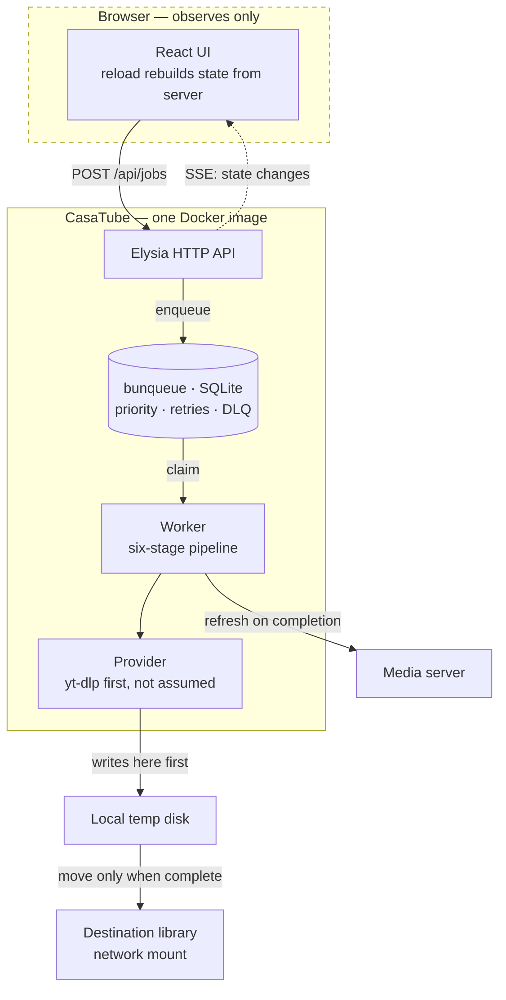
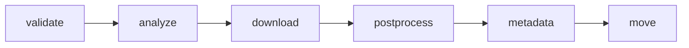
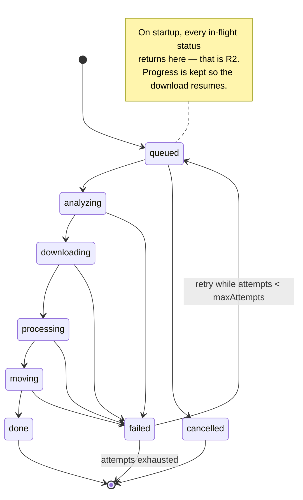

# CasaTube

A self-hosted media downloader that **does not lose your work**.

---

## 1. Why this exists

CasaTube replaces [HomeTube](https://github.com/EgalitarianMonkey/hometube),
which does the hard part well but has one fatal architectural flaw.

HomeTube is a Streamlit app: **the entire job runs inside the browser session**.
There are no threads, no queue, no background worker — verified by reading its
source. When the websocket drops, the job dies silently, wherever it was.

Measured on 2026-08-25 in real use: **3 out of 3 downloads died mid-way.** Each
one downloaded hundreds of MB successfully, then stopped before moving the file
to its destination. No error, no notification — the file just sat in a temp
folder. Every one had to be finished by hand.

> **The one requirement everything else serves: a job must survive both the
> browser closing and the service restarting.** If that is not true, nothing
> else about this project matters.

---

## 2. Hard requirements

| # | Requirement | Why |
|---|---|---|
| R1 | A job survives the browser closing | The failure that motivates the project |
| R2 | A job survives the service restarting | In-flight jobs return to the queue, not oblivion |
| R3 | **The browser only observes** | It never executes. Reloading rebuilds state from the server |
| R4 | Runs anywhere via Docker | Ships as one image; CasaOS is the target host |
| R5 | Open to sources beyond yt-dlp | yt-dlp first, but the architecture must not assume it |
| R6 | Correct language tags on output | HomeTube gets this wrong — see §4.1 |
| R7 | Audio and subtitle language are independent | HomeTube couples them — see §4.1 |

---

## 3. Architecture



**Download to local disk, move at the end.** The destination is typically a
network mount. Writing there during a download is slow and leaves partial files
visible to the media server. Measured on the reference deployment: **28 Mbps** to
the remote host, and writes are not visible immediately (write-back cache).

---

## 4. What we learned from a day of using HomeTube

### 4.1 Three bugs to not reproduce

**🔴 Wrong language tags in the output container.** HomeTube tags tracks `por`
(Portuguese) and `pan` (Punjabi) on audio that is actually English and Spanish.
Verified against yt-dlp's own format list. The user sees garbage languages in
their media server and assumes the wrong file was downloaded.
→ Map yt-dlp's `format_id` to the real language and pass it explicitly to ffmpeg.

**🔴 Audio and subtitle languages come from the same list.** You cannot ask for
"original audio only, but subtitles in English and Spanish". They are one
setting.
→ Two independent settings.

**🟡 When no language preference matches, it includes everything.** This is how
Portuguese and Punjabi got in: the video had ~20 AI-dubbed audio tracks, none
matched, so it fell back to "add them all".
→ Fall back to the track marked `original`. Never to "all".

### 4.2 yt-dlp gotchas, already paid for

- `--progress-template` with the `download:` prefix writes to **stdout**, but
  `postprocess:` writes to **stderr**. Read both, or post-processing looks like
  a hang.
- **`--color no` does not exist.** It is `--color never`; passing `no` exits
  with code 2 and the message does not say the option is invalid.
- A 1080p download is **several files in sequence** (video + one per audio
  language). Progress computed per file makes the bar reset to 0% on each track.
  Accumulate across files.

### 4.3 The constraint that decides where it runs

**yt-dlp's success depends on the reputation of the outbound IP.**

| Egress | Downloads before blocking |
|---|---|
| Residential | ~20-100 |
| Datacenter / VPS | **5-10** |

This is why CasaTube runs on a home machine even though a server would be more
convenient. It also caps how aggressive we can be: parallel downloads and
frequent channel polling both accelerate blocking.

---

## 5. Providers: the plugin seam

yt-dlp is the first provider, **not the assumption**. Everything above the
provider works in terms of jobs and media, never in terms of yt-dlp flags.

```ts
interface Provider {
  name: string;
  /** Can this provider handle the URL? */
  supports(url: string): boolean;
  /** Metadata + available formats, without downloading. */
  probe(url: string, signal: AbortSignal): Promise<MediaInfo>;
  /** Download, reporting progress. Writes to a working directory. */
  fetch(plan: DownloadPlan, ctx: ProviderContext): Promise<FetchResult>;
  /** Discover items in a channel or playlist. */
  list?(url: string, signal: AbortSignal): Promise<DiscoveredItem[]>;
}
```

Providers are resolved by asking each `supports(url)` in priority order. The
yt-dlp provider answers for the ~1800 sites it handles. Later providers can be
direct APIs, other tools, or per-site extractors — without touching the queue,
the pipeline or the UI.

**The seam is not free**: `MediaInfo` and `DownloadPlan` must describe formats,
audio tracks, subtitles and languages in provider-neutral terms. Getting that
vocabulary right is the main design risk of this project.

---

## 6. A job is a pipeline, not a status

Six stages, each with its own state, so the UI can show where a job actually is:



The global status is derived from the running stage. Every stage records when it
started, when it finished, and its error if it failed. Per-job logs are kept and
exposed — when something fails at 3am, the log is the whole story.

**The status machine is where R1 and R2 live:**



---

## 7. Scope

All of the reference designs, built in this order. Each phase must be **usable
and verified** before the next begins.

| Phase | Delivers | Done when |
|---|---|---|
| **1 — Core** | queue, worker, providers, pipeline | A job survives `docker restart` mid-download and completes |
| **2 — API + minimal UI** | Elysia routes, SSE, functional queue view | Closing the browser mid-download changes nothing |
| **3 — Library** | browse what was downloaded | Lists a real library over a network mount without stalling |
| **4 — Automation** | playlists, subscriptions, watchlist, scheduler | A new channel upload is enqueued unattended |
| **5 — Real UI** | shadcn/ui + Tailwind, the full dashboard | Matches the reference designs |
| **6 — Settings & polish** | preferences, storage, analytics, health | Everything configurable from the UI |

---

## 8. Frontend

The reference designs are shadcn-shaped — sidebar shell, cards, data tables,
inspector panels. That makes the component stack a consequence of the designs,
not a preference:

**shadcn/ui + Tailwind + Radix** as the base, with two component registries on
top:

- **[Dice UI](https://diceui.com)** — installed through the shadcn CLI
  (`shadcn add @diceui/…`). Its
  [media-player](https://diceui.com/docs/components/base/media-player) is the
  one we specifically want: video and audio, custom controls, seeking, speed,
  captions, fullscreen, PiP, HLS.
- **[reui.io](https://reui.io)** — second source for anything Dice UI does not
  cover.

### Talking to the backend: Eden Treaty

**[Eden](https://elysiajs.com/eden/overview) is how the frontend calls the API** —
not `fetch`, not a hand-written client. Eden Treaty derives a fully typed client
from the server's own type:

```ts
import { treaty } from "@elysiajs/eden";
import type { App } from "../server";

const api = treaty<App>("");
const { data, error } = await api.jobs.post({ url, destination, preferences });
```

Why it matters here: the API surface is large (jobs, sources, library, stats,
scheduler, settings) and **still moving**. With Eden, renaming a route or
changing a payload becomes a **compile error in the frontend** instead of a
runtime 404 found by clicking around. The `Job` shape flows from Drizzle's schema
through Elysia to the React components with no hand-maintained duplicate.

⚠️ **Consequence to accept up front**: Eden requires the frontend to import the
server's *type*. Server and web must live in the same TypeScript project so the
type is reachable. That rules out splitting them into separate repositories
later without giving up Eden or publishing the types as a package.

### Routing: TanStack Router

Ten or so screens, most of them with state that belongs in the URL.

**[TanStack Router](https://tanstack.com/router)**, chosen for one concrete
reason: **typed and validated search params**. The Library screen filters by
media type, source, resolution, tags and sort order; the Queue filters by status;
the Downloads screen has tabs. All of that belongs in the URL so a view can be
shared, bookmarked and survive a reload — and TanStack Router types and validates
those params instead of leaving them as untyped strings.

Rejected: **React Router v7**, whose centre of gravity has moved to the
framework/SSR mode — we serve a plain SPA from Elysia and would carry weight we
do not use. **Wouter**, too minimal once search-param typing matters.

⚠️ **Integration detail**: client-side routing means Elysia needs a catch-all
serving `index.html` for any non-`/api` path, or a deep link reloads into a 404.

### Where the media player earns its place

Two moments, both of which remove a reason to leave CasaTube:

1. **Before downloading** — `probe()` returns metadata and formats, so the user
   can preview and confirm they are queueing the right thing.
2. **After downloading** — play the result in place, instead of switching to the
   media server to check whether it came out right.

### The rule the frontend exists to respect

**R3: the browser only observes.** This is a structural constraint, not a
guideline:

- A **data layer** (API client + SSE subscription) is the only thing that talks
  to the server. Presentation components receive props and render.
- Reloading the page rebuilds the entire state from the server. Nothing lives
  only in the browser.
- Reskinning must be possible without touching the data layer. The first attempt
  at this project was thrown away partly because that separation was not
  enforced early.

### Decided up front, because retrofitting is expensive

**Light and dark.** Both appear in the designs. Theme tokens from the first
component, honouring `prefers-color-scheme` plus an explicit toggle. Bolting
dark mode on later means revisiting every component.

**Mobile.** Santi uses an iPad. The queue and the download form must be usable
on a small screen; the dense inspector panels can degrade to full-screen views.

**English strings, inline. No i18n yet.** If localisation is ever wanted, the
answer is i18n — not rewriting the UI in another language.

### Risk worth naming

The shadcn registry model **copies components into the repository** rather than
adding a dependency. That means we own them: no automatic upstream fixes, and
updates are a manual re-copy. It is the accepted trade-off of this ecosystem,
but it should be a conscious one — the components become our code.

## 9. Stack, and why

| Choice | Why | Alternative rejected |
|---|---|---|
| **Bun + TypeScript** | One runtime for server, worker and build. Native SQLite, test runner, bundler | Node (extra tooling) |
| **Elysia** | Bun-native, schema validation, ~20 endpoints need real routing | Hand-rolled `Bun.serve` |
| **Drizzle ORM** | Schema as code doubles as the type source; `drizzle-kit` **generates** migrations from the schema diff | Kysely (see below); raw SQL |
| **bunqueue** | SQLite-backed, **no Redis**. Brings priority, retries with backoff, DLQ, cron and idempotency already built | BullMQ (needs Redis); effect-mq (**no SQLite**); writing our own |
| **yt-dlp as external binary** | Updates independently of the app — and its freshness is exactly what breaks | yt-dlp as a Python library |
| **React + shadcn/ui + Tailwind** | The designs are shadcn-shaped; component libraries build on it | Hand-written CSS |
| **SSE** | One-way server→browser is all we need | WebSockets |
| **better-result** | Typed `Result`, and `Result.gen` keeps fallible code linear | Effect (see §10); neverthrow (**0 releases in 12 months**) |

---

### On Kysely, accurately

An earlier draft of this plan said Kysely has no migrations. **That was wrong** —
Kysely ships a real
[migration system](https://kysely.dev/docs/migrations): `Migrator`, migration
files, providers, up and down.

The actual difference is who *writes* them. With Kysely you author each migration
by hand and keep it in step with your types. With Drizzle the schema is declared
once, `drizzle-kit` derives the migration from the diff, and `$inferSelect` makes
that same schema the source of the TypeScript types.

That single-source property is the reason for the choice, and it is aimed at a
problem this project already had: in the first attempt, two modules had drifted
into **two different definitions of `Preferences`** in the same folder. Kysely
would type queries beautifully and still let that happen.

Kysely remains a reasonable alternative if hand-written SQL migrations are
preferred to generated ones.

## 10. Errors

Failure is normal here, not exceptional: a site changes, a format disappears, a
network mount stalls, a provider gets rate-limited. Code that treats every one of
those as a surprise ends up as nested `try`/`catch` around ad-hoc `{ ok: true }`
objects — which is exactly what the first attempt turned into.

### Rules

1. **One `Result<T, E>`, everywhere.** No module invents its own way to fail.
2. **Errors are typed and distinguishable** by the caller. `"something went
   wrong"` is not an error type.
3. **`throw` is reserved for defects** — bugs and impossible states. Expected
   failure travels in the return type where the compiler can see it.
4. **Errors carry context**: which URL, which stage, which provider.
5. **Conversion happens at boundaries only** — HTTP layer turns a `Result` into a
   status code, the worker turns one into a failed stage. Nowhere else.

### `Result.gen` is the point

The reason for this library rather than a hand-rolled type: fallible code stays
**linear**.

```ts
const outcome = Result.gen(function* () {
  const info = yield* provider.probe(url);
  const plan = yield* selectFormats(info, preferences);
  const file = yield* provider.fetch(plan, ctx);
  return yield* moveIntoLibrary(file, destination);
});
```

Any step that fails short-circuits with its typed error and the rest does not
run. It reads top to bottom.

### The error taxonomy

Each domain owns its failure modes, so a handler can react to the *kind* of
problem rather than string-matching a message:

| Domain | Errors |
|---|---|
| Provider | `UnsupportedUrl`, `ProbeFailed`, `Blocked`, `RateLimited`, `AuthRequired`, `FormatUnavailable` |
| Worker | `StageFailed`, `Cancelled`, `Timeout`, `DiskFull` |
| Library | `MountUnavailable`, `PathOutsideRoot`, `NotFound` |
| Queue | `NotFound`, `InvalidTransition` |

`Blocked` and `RateLimited` matter most: they are the ones that should back off
and, per §4.3, they are the ones the IP budget makes expensive.

### Why not Effect

Effect would give all of the above natively, plus `Schedule` for retries, fiber
interruption for cancellation, and `Layer` for dependency injection. It is the
more powerful answer and it was seriously considered.

Rejected **for v1**, on timing rather than merit:

- It is a whole-codebase paradigm. Every function changes shape, and the payoff
  arrives after the cost.
- This project has not downloaded a single video yet. Its main risk is stalling
  before it works, which already happened once.
- Its three biggest wins here have cheap substitutes: typed errors from
  `Result`, retries from the queue, cancellation from `AbortSignal`.
- Its HTTP layer still lives under `effect/unstable/httpapi`.

📌 **Revisit when** CasaTube works and we know where it actually hurts. If the
worker pipeline fills up with cancellation and resource-cleanup edge cases,
Effect stops being elegance and becomes the right tool — and by then `HttpApi`
will likely have stabilised. Note that `Schema` can be adopted standalone,
without the runtime, if stricter validation is wanted before that.

⚠️ **Accepted cost of `better-result`**: three major versions and 27 releases in
twelve months. The API moves. Acceptable for a library this small, but it is not
frozen.

### On the queue

**Decided: bunqueue.** Writing our own was considered and rejected — it would
mean rebuilding priority ordering, backoff, a dead-letter queue and cron, all of
which bunqueue already ships, on the way to a first working download.

Noted for the record, since it was weighed: the package is young (first published
January 2026) and releases often. Santi's call, explicitly: *«me importa 5 lo de
7 meses de vida»*. The trade is fewer days spent on plumbing.

**Two integration questions to settle in phase 1**, neither of them objections:

1. ~~One database or two?~~ **Settled: two is fine.** bunqueue keeps its own
   SQLite file, Drizzle keeps ours. Both live in `DATA_DIR`, so one volume still
   holds everything and a backup that copies the directory covers both.
   ⚠️ Consequence: a job's queue state and its `Job` row are in **separate
   databases**, so they cannot be updated in one transaction. They can drift —
   the queue can hold an entry whose `Job` row says otherwise. Reconciliation on
   startup has to cover that, not just in-flight statuses.
2. **R2 still has to be proven.** Persistence is not the same as resumption.
   Adopting a queue library does not discharge the requirement: we still verify
   that a `docker restart` mid-download returns the job to the queue and it
   completes. That is the acceptance test either way.

**Keep it behind a narrow interface** — `enqueue`, `claimNext`, `update`,
`recoverOnStart`. Not because we expect to swap it, but because the queue is
where R1 and R2 live, and a seam there costs nothing today and keeps the option
open if it ever becomes necessary.

## 11. Data model

The contract every module shares. It lives in the Drizzle schema; these are the
inferred shapes.

```ts
type JobStatus =
  | "queued" | "analyzing" | "downloading" | "processing"
  | "moving" | "done" | "failed" | "cancelled";

type StageName =
  | "validate" | "analyze" | "download" | "postprocess" | "metadata" | "move";

type Priority = "high" | "normal" | "low";

interface Stage {
  name: StageName;
  status: "pending" | "running" | "done" | "failed" | "skipped";
  startedAt?: string;
  finishedAt?: string;
  error?: string;
}

interface Job {
  id: string;
  url: string;
  provider: string;          // which Provider claimed it
  destination: string;       // library subfolder
  title: string | null;      // cleaned, safe as a filename
  status: JobStatus;         // derived from the running stage
  stages: Stage[];
  priority: Priority;
  attempts: number;
  maxAttempts: number;
  paused: boolean;
  progress: number;          // 0..100, accumulated across files
  totalBytes: number | null;
  doneBytes: number | null;
  speed: number | null;      // bytes/s
  eta: number | null;        // seconds
  thumbnail: string | null;
  duration: number | null;   // seconds
  source: string | null;     // "youtube", "vimeo"…
  log: string[];
  error: string | null;
  outputFile: string | null;
  createdAt: string;
  updatedAt: string;
}

interface Preferences {
  originalOnly: boolean;        // exactly one audio track: the original
  audioLanguages: string[];
  subtitleLanguages: string[];  // ⚠️ independent of audio — R7
  maxResolution: number;
  sponsorblock: boolean;
}

interface Source {              // channel, playlist or watch target
  id: string;
  url: string;
  name: string;
  destination: string;
  preferences: Preferences;
  intervalMinutes: number;
  enabled: boolean;
  lastCheckedAt: string | null;
}
```

**Seen-items are tracked per source.** Re-checking a source must not re-enqueue
what it already saw, and adding a source must not enqueue its entire back
catalogue — a channel with 800 videos would flood the queue and burn the IP
budget. Adding a source marks current items as seen; only what appears *after*
is enqueued, unless explicitly asked otherwise with a cap.

## 12. Configuration

Everything by environment variable, so the image is the only artefact.

| Variable | Default | Notes |
|---|---|---|
| `PORT` | `8520` | HTTP |
| `DATA_DIR` | `/data` | Database and state. One volume |
| `TEMP_DIR` | `/data/tmp` | Downloads land here first |
| `LIBRARY_DIR` | `/library` | Destination root. Often a network mount |
| `MAX_CONCURRENT` | `1` | See §13 — raising this raises blocking risk |
| `COOKIES_FILE` | unset | See below |
| `MEDIA_SERVER_URL` / `MEDIA_SERVER_TOKEN` | unset | Refresh hook after a job completes |
| `LOG_LEVEL` | `info` | |

### Cookies

Some content needs a logged-in session — age-gated video, members-only
uploads, and the *"Sign in to confirm you're not a bot"* challenge that appears
once an IP looks suspicious.

⚠️ **Cookies are credentials.** They belong on disk with restrictive permissions,
never in the repository, never in a log line, and never echoed back through the
API. They also **expire within hours**, and reusing them from a different IP than
the one that created them is itself a signal — so treat them as a mitigation, not
a fix.

## 13. What this is not

Naming non-goals now prevents scope drift later.

- **Not a media server.** It downloads and organises; something else plays and
  transcodes. The only integration is a refresh call.
- **Not a torrent or debrid client.** Different pipeline entirely.
- **Not multi-user.** One household, one library. No accounts, no per-user
  quotas — that assumption is what makes deferring auth reasonable.
- **Not a transcoder.** ffmpeg is used to remux, embed subtitles and fix
  metadata. Re-encoding is out of scope.
- **Not a scraper of arbitrary sites.** Support comes from providers; if no
  provider handles a URL, it is refused clearly rather than half-attempted.

## 14. Packaging

**One Docker image, self-contained**: the app, **yt-dlp** and **ffmpeg** inside.
No host dependencies. It must run on plain Docker, Docker Compose, or CasaOS.

⚠️ **Tag the image with the yt-dlp build date**, not just the app version.
yt-dlp breaks when sites change; pinning a bare app version silently pins a
stale yt-dlp. Upstream HomeTube does this and it is the right call.

Configuration by environment variables. Persistent state in one volume.

---

## 15. Open tensions — decide, do not drift

**Concurrent downloads.** The designs show a limit of 4. Default here is **1**,
because parallel requests accelerate IP blocking (§4.3). Configurable, with the
consequence stated in the UI where it is set.

**Deleting from the library.** The designs include a delete button. That library
is served by a media server, over a network mount — **deletion is not
reversible**. Default off. If enabled: explicit confirmation, never bulk, and
an audit record.

**Authentication is deliberately deferred.** Not a blocker for a self-hosted LAN
tool. The consequence, stated so it stays a decision rather than an oversight:
**anyone on the network can enqueue downloads and browse the library.** That is
acceptable on a home LAN and stops being acceptable the moment CasaTube is
exposed beyond it — at which point auth becomes blocking.

---

## 16. Verification

"Done" means observed working, not "the tests pass". Each phase in §7 has a
condition that can only be met by doing the thing.

**Unit tests** for pure logic — format and language selection above all, because
it decides what lands in the library and it is where HomeTube's bugs live.

**Integration tests** against a real SQLite file, not `:memory:`. The restart
requirement (R2) is only meaningfully tested by closing and reopening the
database; in memory, the test proves nothing.

**End-to-end** against the real `yt-dlp` binary and a local HTTP server, so no
network and no site is involved but the actual subprocess contract is exercised.
That is how the two gotchas in §4.2 were found — reading the documentation would
not have surfaced either.

**Manual acceptance per phase**, and the two that matter most:

- Start a download, **close the browser**, reopen it. The job finished. (R1)
- Start a download, **`docker restart`** mid-flight. The job resumes and
  completes. (R2)

⚠️ **Watch out for instruments that lie.** Several checks during the first
attempt reported the wrong thing: `grep -c` counted commented-out lines as
enabled config; a container registry paginated its tag list so a published
version looked missing; a status endpoint excluded exactly the item type being
verified. Before concluding something is absent or broken, confirm the check
could have seen it.

## 17. How this gets built

The reason this plan exists: the first attempt was orchestrated badly. Work was
handed to parallel agents before the requirements were settled, and the brief
then changed three times mid-flight — language, scope, framework. The code was
not the problem.

- **The plan is settled before work is handed out.** Changes wait for a phase
  boundary.
- **Every phase ends verified**, against reality — not "the tests pass" but "a
  job survived a real restart".
- **Interfaces before implementations.** `Provider`, `Job` and the queue API are
  agreed first; they are what parallel work depends on.
- **English throughout**: code, comments, docs, UI.
