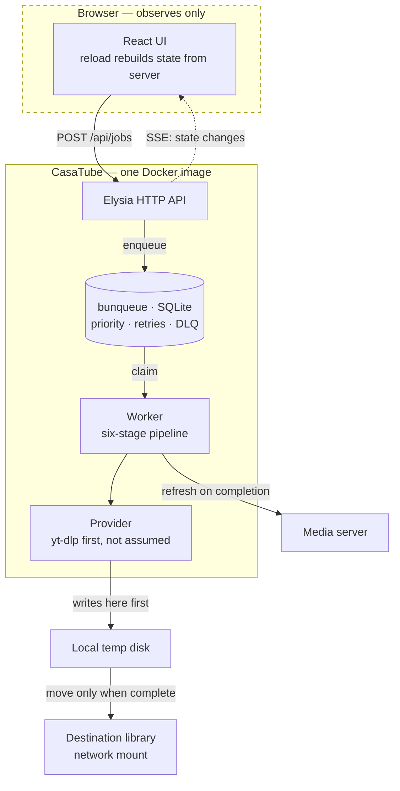
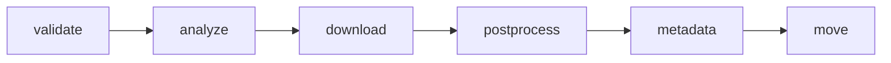
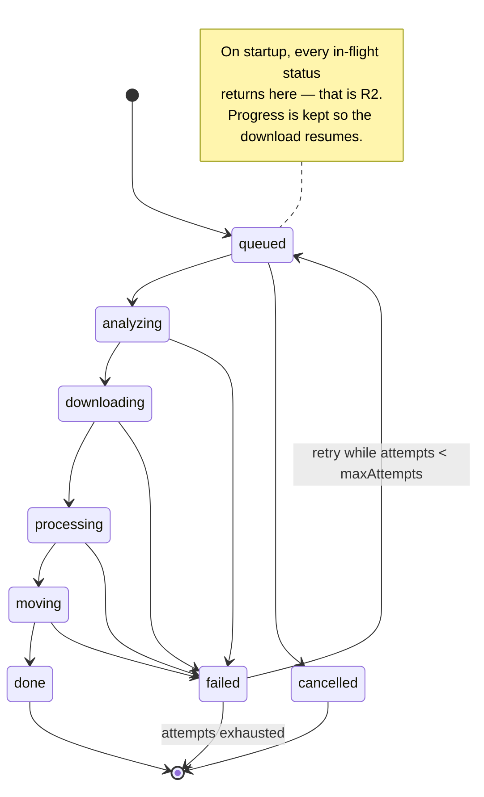

# CasaTube

A self-hosted media downloader that **does not lose your work**.

---

## 1. Why this exists

CasaTube replaces [HomeTube](https://github.com/EgalitarianMonkey/hometube),
which does the hard part well but has one fatal architectural flaw.

HomeTube is a Streamlit app: **the entire job runs inside the browser session**.
There are no threads, no queue, no background worker — verified by reading its
source. When the websocket drops, the job dies silently, wherever it was.

Measured on 2026-08-25 in real use: **3 out of 3 downloads died mid-way.** Each
one downloaded hundreds of MB successfully, then stopped before moving the file
to its destination. No error, no notification — the file just sat in a temp
folder. Every one had to be finished by hand.

> **The one requirement everything else serves: a job must survive both the
> browser closing and the service restarting.** If that is not true, nothing
> else about this project matters.

---

## 2. Hard requirements

| # | Requirement | Why |
|---|---|---|
| R1 | A job survives the browser closing | The failure that motivates the project |
| R2 | A job survives the service restarting | In-flight jobs return to the queue, not oblivion |
| R3 | **The browser only observes** | It never executes. Reloading rebuilds state from the server |
| R4 | Runs anywhere via Docker | Ships as one image; CasaOS is the target host |
| R5 | Open to sources beyond yt-dlp | yt-dlp first, but the architecture must not assume it |
| R6 | Correct language tags on output | HomeTube gets this wrong — see §4.1 |
| R7 | Audio and subtitle language are independent | HomeTube couples them — see §4.1 |

---

## 3. Architecture



**Download to local disk, move at the end.** The destination is typically a
network mount. Writing there during a download is slow and leaves partial files
visible to the media server. Measured on the reference deployment: **28 Mbps** to
the remote host, and writes are not visible immediately (write-back cache).

---

## 4. What we learned from a day of using HomeTube

### 4.1 Three bugs to not reproduce

**🔴 Wrong language tags in the output container.** HomeTube tags tracks `por`
(Portuguese) and `pan` (Punjabi) on audio that is actually English and Spanish.
Verified against yt-dlp's own format list. The user sees garbage languages in
their media server and assumes the wrong file was downloaded.
→ Map yt-dlp's `format_id` to the real language and pass it explicitly to ffmpeg.

**🔴 Audio and subtitle languages come from the same list.** You cannot ask for
"original audio only, but subtitles in English and Spanish". They are one
setting.
→ Two independent settings.

**🟡 When no language preference matches, it includes everything.** This is how
Portuguese and Punjabi got in: the video had ~20 AI-dubbed audio tracks, none
matched, so it fell back to "add them all".
→ Fall back to the track marked `original`. Never to "all".

### 4.2 yt-dlp gotchas, already paid for

- `--progress-template` with the `download:` prefix writes to **stdout**, but
  `postprocess:` writes to **stderr**. Read both, or post-processing looks like
  a hang.
- **`--color no` does not exist.** It is `--color never`; passing `no` exits
  with code 2 and the message does not say the option is invalid.
- A 1080p download is **several files in sequence** (video + one per audio
  language). Progress computed per file makes the bar reset to 0% on each track.
  Accumulate across files.

### 4.3 The constraint that decides where it runs

**yt-dlp's success depends on the reputation of the outbound IP.**

| Egress | Downloads before blocking |
|---|---|
| Residential | ~20-100 |
| Datacenter / VPS | **5-10** |

This is why CasaTube runs on a home machine even though a server would be more
convenient. It also caps how aggressive we can be: parallel downloads and
frequent channel polling both accelerate blocking.

---

## 5. Providers: the plugin seam

yt-dlp is the first provider, **not the assumption**. Everything above the
provider works in terms of jobs and media, never in terms of yt-dlp flags.

```ts
interface Provider {
  name: string;
  /** Can this provider handle the URL? */
  supports(url: string): boolean;
  /** Metadata + available formats, without downloading. */
  probe(url: string, signal: AbortSignal): Promise<MediaInfo>;
  /** Download, reporting progress. Writes to a working directory. */
  fetch(plan: DownloadPlan, ctx: ProviderContext): Promise<FetchResult>;
  /** Discover items in a channel or playlist. */
  list?(url: string, signal: AbortSignal): Promise<DiscoveredItem[]>;
}
```

Providers are resolved by asking each `supports(url)` in priority order. The
yt-dlp provider answers for the ~1800 sites it handles. Later providers can be
direct APIs, other tools, or per-site extractors — without touching the queue,
the pipeline or the UI.

**The seam is not free**: `MediaInfo` and `DownloadPlan` must describe formats,
audio tracks, subtitles and languages in provider-neutral terms. Getting that
vocabulary right is the main design risk of this project.

---

## 6. A job is a pipeline, not a status

Six stages, each with its own state, so the UI can show where a job actually is:



The global status is derived from the running stage. Every stage records when it
started, when it finished, and its error if it failed. Per-job logs are kept and
exposed — when something fails at 3am, the log is the whole story.

**The status machine is where R1 and R2 live:**



---

## 7. Scope

All of the reference designs, built in this order. Each phase must be **usable
and verified** before the next begins.

| Phase | Delivers | Done when |
|---|---|---|
| **1 — Core** | queue, worker, providers, pipeline | A job survives `docker restart` mid-download and completes |
| **2 — API + minimal UI** | Elysia routes, SSE, functional queue view | Closing the browser mid-download changes nothing |
| **3 — Library** | browse what was downloaded | Lists a real library over a network mount without stalling |
| **4 — Automation** | playlists, subscriptions, watchlist, scheduler | A new channel upload is enqueued unattended |
| **5 — Real UI** | shadcn/ui + Tailwind, the full dashboard | Matches the reference designs |
| **6 — Settings & polish** | preferences, storage, analytics, health | Everything configurable from the UI |

---

## 8. Frontend

The reference designs are shadcn-shaped — sidebar shell, cards, data tables,
inspector panels. That makes the component stack a consequence of the designs,
not a preference:

**shadcn/ui + Tailwind + Radix** as the base, with two component registries on
top:

- **[Dice UI](https://diceui.com)** — installed through the shadcn CLI
  (`shadcn add @diceui/…`). Its
  [media-player](https://diceui.com/docs/components/base/media-player) is the
  one we specifically want: video and audio, custom controls, seeking, speed,
  captions, fullscreen, PiP, HLS.
- **[reui.io](https://reui.io)** — second source for anything Dice UI does not
  cover.

### Talking to the backend: Eden Treaty

**[Eden](https://elysiajs.com/eden/overview) is how the frontend calls the API** —
not `fetch`, not a hand-written client. Eden Treaty derives a fully typed client
from the server's own type:

```ts
import { treaty } from "@elysiajs/eden";
import type { App } from "../server";

const api = treaty<App>("");
const { data, error } = await api.jobs.post({ url, destination, preferences });
```

Why it matters here: the API surface is large (jobs, sources, library, stats,
scheduler, settings) and **still moving**. With Eden, renaming a route or
changing a payload becomes a **compile error in the frontend** instead of a
runtime 404 found by clicking around. The `Job` shape flows from Drizzle's schema
through Elysia to the React components with no hand-maintained duplicate.

⚠️ **Consequence to accept up front**: Eden requires the frontend to import the
server's *type*. Server and web must live in the same TypeScript project so the
type is reachable. That rules out splitting them into separate repositories
later without giving up Eden or publishing the types as a package.

### Routing: TanStack Router

Ten or so screens, most of them with state that belongs in the URL.

**[TanStack Router](https://tanstack.com/router)**, chosen for one concrete
reason: **typed and validated search params**. The Library screen filters by
media type, source, resolution, tags and sort order; the Queue filters by status;
the Downloads screen has tabs. All of that belongs in the URL so a view can be
shared, bookmarked and survive a reload — and TanStack Router types and validates
those params instead of leaving them as untyped strings.

Rejected: **React Router v7**, whose centre of gravity has moved to the
framework/SSR mode — we serve a plain SPA from Elysia and would carry weight we
do not use. **Wouter**, too minimal once search-param typing matters.

⚠️ **Integration detail**: client-side routing means Elysia needs a catch-all
serving `index.html` for any non-`/api` path, or a deep link reloads into a 404.

### Where the media player earns its place

Two moments, both of which remove a reason to leave CasaTube:

1. **Before downloading** — `probe()` returns metadata and formats, so the user
   can preview and confirm they are queueing the right thing.
2. **After downloading** — play the result in place, instead of switching to the
   media server to check whether it came out right.

### The rule the frontend exists to respect

**R3: the browser only observes.** This is a structural constraint, not a
guideline:

- A **data layer** (API client + SSE subscription) is the only thing that talks
  to the server. Presentation components receive props and render.
- Reloading the page rebuilds the entire state from the server. Nothing lives
  only in the browser.
- Reskinning must be possible without touching the data layer. The first attempt
  at this project was thrown away partly because that separation was not
  enforced early.

### Decided up front, because retrofitting is expensive

**Light and dark.** Both appear in the designs. Theme tokens from the first
component, honouring `prefers-color-scheme` plus an explicit toggle. Bolting
dark mode on later means revisiting every component.

**Mobile.** Santi uses an iPad. The queue and the download form must be usable
on a small screen; the dense inspector panels can degrade to full-screen views.

**English strings, inline. No i18n yet.** If localisation is ever wanted, the
answer is i18n — not rewriting the UI in another language.

### Risk worth naming

The shadcn registry model **copies components into the repository** rather than
adding a dependency. That means we own them: no automatic upstream fixes, and
updates are a manual re-copy. It is the accepted trade-off of this ecosystem,
but it should be a conscious one — the components become our code.

## 9. Stack, and why

| Choice | Why | Alternative rejected |
|---|---|---|
| **Bun + TypeScript** | One runtime for server, worker and build. Native SQLite, test runner, bundler | Node (extra tooling) |
| **Elysia** | Bun-native, schema validation, ~20 endpoints need real routing | Hand-rolled `Bun.serve` |
| **Drizzle ORM** | Schema as code = single source of truth for types; versioned migrations | Kysely (migrations by hand); raw SQL |
| **bunqueue** | SQLite-backed, **no Redis**, brings priority/retries/DLQ/cron | BullMQ (needs Redis); own queue (rebuilding solved problems) |
| **yt-dlp as external binary** | Updates independently of the app — and its freshness is exactly what breaks | yt-dlp as a Python library |
| **React + shadcn/ui + Tailwind** | The designs are shadcn-shaped; component libraries build on it | Hand-written CSS |
| **SSE** | One-way server→browser is all we need | WebSockets |

---

## 10. Packaging

**One Docker image, self-contained**: the app, **yt-dlp** and **ffmpeg** inside.
No host dependencies. It must run on plain Docker, Docker Compose, or CasaOS.

⚠️ **Tag the image with the yt-dlp build date**, not just the app version.
yt-dlp breaks when sites change; pinning a bare app version silently pins a
stale yt-dlp. Upstream HomeTube does this and it is the right call.

Configuration by environment variables. Persistent state in one volume.

---

## 11. Open tensions — decide, do not drift

**Concurrent downloads.** The designs show a limit of 4. Default here is **1**,
because parallel requests accelerate IP blocking (§4.3). Configurable, with the
consequence stated in the UI where it is set.

**Deleting from the library.** The designs include a delete button. That library
is served by a media server, over a network mount — **deletion is not
reversible**. Default off. If enabled: explicit confirmation, never bulk, and
an audit record.

**Authentication is deliberately deferred.** Not a blocker for a self-hosted LAN
tool. The consequence, stated so it stays a decision rather than an oversight:
**anyone on the network can enqueue downloads and browse the library.** That is
acceptable on a home LAN and stops being acceptable the moment CasaTube is
exposed beyond it — at which point auth becomes blocking.

---

## 12. How this gets built

The reason this plan exists: the first attempt was orchestrated badly. Work was
handed to parallel agents before the requirements were settled, and the brief
then changed three times mid-flight — language, scope, framework. The code was
not the problem.

- **The plan is settled before work is handed out.** Changes wait for a phase
  boundary.
- **Every phase ends verified**, against reality — not "the tests pass" but "a
  job survived a real restart".
- **Interfaces before implementations.** `Provider`, `Job` and the queue API are
  agreed first; they are what parallel work depends on.
- **English throughout**: code, comments, docs, UI.
