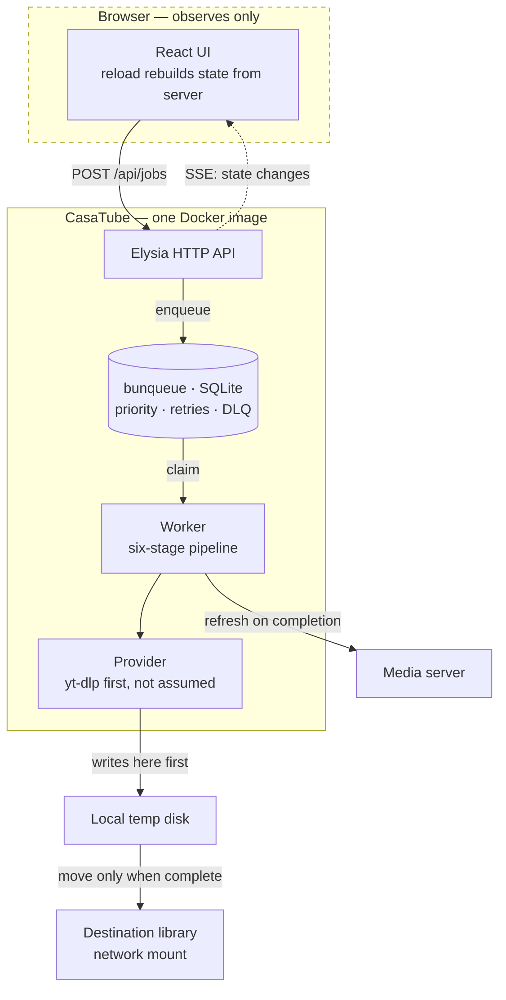
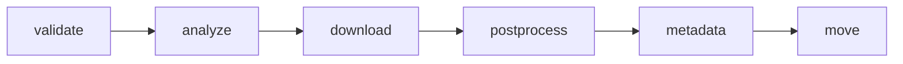
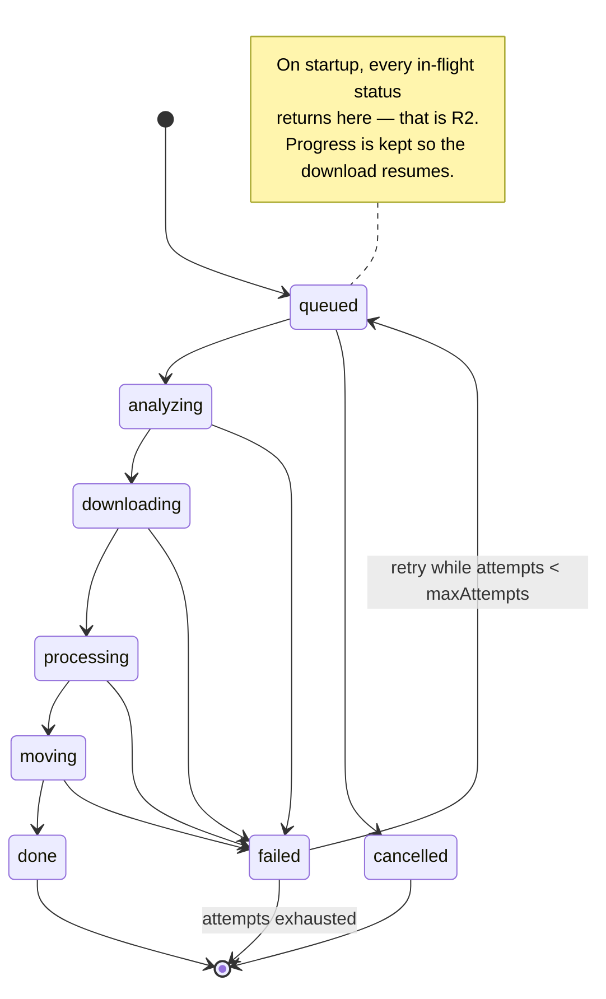

# CasaTube

A self-hosted media downloader that **does not lose your work**.

---

## 1. Why this exists

CasaTube replaces [HomeTube](https://github.com/EgalitarianMonkey/hometube),
which does the hard part well but has one fatal architectural flaw.

HomeTube is a Streamlit app: **the entire job runs inside the browser session**.
There are no threads, no queue, no background worker — verified by reading its
source. When the websocket drops, the job dies silently, wherever it was.

Measured on 2026-08-25 in real use: **3 out of 3 downloads died mid-way.** Each
one downloaded hundreds of MB successfully, then stopped before moving the file
to its destination. No error, no notification — the file just sat in a temp
folder. Every one had to be finished by hand.

> **The one requirement everything else serves: a job must survive both the
> browser closing and the service restarting.** If that is not true, nothing
> else about this project matters.

---

## 2. Hard requirements

| # | Requirement | Why |
|---|---|---|
| R1 | A job survives the browser closing | The failure that motivates the project |
| R2 | A job survives the service restarting | In-flight jobs return to the queue, not oblivion |
| R3 | **The browser only observes** | It never executes. Reloading rebuilds state from the server |
| R4 | Runs anywhere via Docker | Ships as one image; CasaOS is the target host |
| R5 | Open to sources beyond yt-dlp | yt-dlp first, but the architecture must not assume it |
| R6 | Correct language tags on output | HomeTube gets this wrong — see §4.1 |
| R7 | Audio and subtitle language are independent | HomeTube couples them — see §4.1 |

---

## 3. Architecture



**Download to local disk, move at the end.** The destination is typically a
network mount. Writing there during a download is slow and leaves partial files
visible to the media server. Measured on the reference deployment: **28 Mbps** to
the remote host, and writes are not visible immediately (write-back cache).

---

## 4. What we learned from a day of using HomeTube

### 4.1 Three bugs to not reproduce

**🔴 Wrong language tags in the output container.** HomeTube tags tracks `por`
(Portuguese) and `pan` (Punjabi) on audio that is actually English and Spanish.
Verified against yt-dlp's own format list. The user sees garbage languages in
their media server and assumes the wrong file was downloaded.
→ Map yt-dlp's `format_id` to the real language and pass it explicitly to ffmpeg.

**🔴 Audio and subtitle languages come from the same list.** You cannot ask for
"original audio only, but subtitles in English and Spanish". They are one
setting.
→ Two independent settings.

**🟡 When no language preference matches, it includes everything.** This is how
Portuguese and Punjabi got in: the video had ~20 AI-dubbed audio tracks, none
matched, so it fell back to "add them all".
→ Fall back to the track marked `original`. Never to "all".

### 4.2 yt-dlp gotchas, already paid for

- `--progress-template` with the `download:` prefix writes to **stdout**, but
  `postprocess:` writes to **stderr**. Read both, or post-processing looks like
  a hang.
- **`--color no` does not exist.** It is `--color never`; passing `no` exits
  with code 2 and the message does not say the option is invalid.
- A 1080p download is **several files in sequence** (video + one per audio
  language). Progress computed per file makes the bar reset to 0% on each track.
  Accumulate across files.

### 4.3 The constraint that decides where it runs

**yt-dlp's success depends on the reputation of the outbound IP.**

| Egress | Downloads before blocking |
|---|---|
| Residential | ~20-100 |
| Datacenter / VPS | **5-10** |

This is why CasaTube runs on a home machine even though a server would be more
convenient. It also caps how aggressive we can be: parallel downloads and
frequent channel polling both accelerate blocking.

---

## 5. Extension: providers, hooks and plugins

Two different extension points, and telling them apart is what keeps this
coherent.

### Providers answer "how do I get media from this URL?"

yt-dlp is the first provider, **not the assumption**. Everything above the
provider works in terms of jobs and media, never in terms of yt-dlp flags.

```ts
interface Provider {
  name: string;
  /** Can this provider handle the URL? */
  supports(url: string): boolean;
  /** Metadata and available formats, without downloading. */
  probe(url: string, signal: AbortSignal): Promise<Result<MediaInfo, ProviderError>>;
  /** Download, reporting progress, into a working directory. */
  fetch(plan: DownloadPlan, ctx: ProviderContext): Promise<Result<FetchResult, ProviderError>>;
  /** Discover items in a channel or playlist. */
  list?(url: string, signal: AbortSignal): Promise<Result<DiscoveredItem[], ProviderError>>;
}
```

**The yt-dlp provider is built in and cannot be removed.** It answers for the
~1800 sites it handles and is the fallback for everything else. Additional
providers register ahead of it and are asked first — that ordering is what makes
a custom extractor possible for a site yt-dlp does not cover, or covers badly.

If no provider claims a URL, the job is **refused clearly** rather than
half-attempted.

**The seam is not free**: `MediaInfo` and `DownloadPlan` must describe formats,
audio tracks, subtitles and languages in provider-neutral terms. Getting that
vocabulary right is the main design risk of this project.

### Hooks answer "do something at this moment"

Two kinds, and the distinction is the design:

| | Transforming | Observing |
|---|---|---|
| Can change the outcome | yes | no |
| Execution | in order, one after another | in parallel, not awaited |
| On failure | fails the job | logged, job continues |
| Example | unshorten a URL, adjust format selection | refresh the media server, send a notification |

**An observer can never fail a job.** If the media-server refresh fails, the
video is downloaded and correct; marking the job failed would be a lie.

Lifecycle points: `url:resolve` (before a provider is chosen), `job:queued`,
`probe:complete` (the transforming hook that can influence selection),
`download:complete`, `job:completed`, `job:failed`.

### Plugins are how both arrive

A plugin is a `.ts` file in `DATA_DIR/plugins/`. **Bun imports TypeScript
directly, so a simple plugin needs no build step at all.**

```ts
export default registerPlugin(({ on, addProvider, fetch, log, config }) => {
  on("url:resolve",   async (url) => unshorten(url));      // transforming
  on("job:completed", async (job) => refreshLibrary(job)); // observing
});
```

**Capabilities are injected, not imported.** The host hands the plugin `fetch`,
`log`, `config`, and access to the bundled `yt-dlp` and `ffmpeg`. This is what
makes the dependency question mostly disappear: a URL unshortener and a media
server notifier need `fetch` and nothing else.

**When a plugin genuinely needs a library**, the author bundles it —
`bun build plugin.ts --outfile plugin.js` — and drops the single file. This is
the Obsidian and VS Code model, and it is deliberately chosen over running
`npm install` at load time (the Node-RED model), which brings version conflicts,
slow startup, and a supply-chain surface that activates on load rather than on
build.

### Plugins declare themselves, and the user chooses

A plugin is not a black box that quietly runs on everything. It **declares** what
it is for, and that declaration is static metadata — readable **before any of its
code executes**.

```ts
export default registerPlugin({
  name: "adfly-bypass",
  description: "Resolves adf.ly and similar shortener links to their target",
  matches: ["adf.ly", "*.adfly.com", "sh.st"],   // hosts it claims
  hooks: [{ at: "url:resolve", kind: "transform", before: "provider:resolve" }],
  needs: ["network"],                             // capabilities requested
  setup({ on, fetch, log }) {
    on("url:resolve", async (url) => resolve(url));
  },
});
```

**Because `matches` is evaluated before execution**, the UI can do something
useful: paste a URL and CasaTube shows which plugins *would* apply, what each
would do, and a toggle for each.

- **Global default** per plugin: on, off, or ask.
- **Per-download override** in the download window — the recommendation comes
  from `matches`, the decision stays with the user.
- **Ordering is explicit** (`before` / `after`), so two transforming hooks at the
  same point have a defined sequence rather than whatever load order produced.

### Capabilities are declared — and that is a UI contract, not a sandbox

`needs` lists what a plugin asks for: `network`, `library:read`,
`library:write`, `cookies`, `subprocess`. The host injects exactly those and
shows them at install time, the way a phone shows permissions.

⚠️ **Be honest about what this enforces.** Withholding a capability works for a
*well-behaved* plugin: it simply is not handed `fetch`. It does **not** stop a
malicious one, because an in-process TypeScript module can import Bun and Node
APIs directly. Bun has no Deno-style permission flags to fall back on.

So the declaration is real UX and real documentation — you can see that a
notifier asks only for `network`, and be suspicious of one asking for `cookies` —
but it is **not a security boundary**. Making it one needs process isolation, and
that is worth doing only when third-party plugins are actually distributed.

⚠️ **A plugin runs in-process with CasaTube's own privileges.** It can read the
filesystem and see cookies. Acceptable for a self-hosted tool whose plugins you
write yourself; **it stops being acceptable if third-party plugins are ever
distributed**, and that is the moment to look at isolation rather than before.

📌 **The media-server refresh is the first observing plugin**, not code welded
into the worker. Today it is a `POST /Library/Refresh` with an `X-Emby-Token`
header — verified working against the reference deployment. Making it a plugin
is what lets someone use Plex or Emby without touching the core.

## 6. A job is a pipeline, not a status

Six stages, each with its own state, so the UI can show where a job actually is:



The global status is derived from the running stage. Every stage records when it
started, when it finished, and its error if it failed. Per-job logs are kept and
exposed — when something fails at 3am, the log is the whole story.

**The status machine is where R1 and R2 live:**



---

## 7. Scope

All of the reference designs, built in this order. Each phase must be **usable
and verified** before the next begins.

| Phase | Delivers | Done when |
|---|---|---|
| **1 — Core** | queue, worker, providers, pipeline | A job survives `docker restart` mid-download and completes |
| **2 — API + minimal UI** | Elysia routes, SSE, functional queue view | Closing the browser mid-download changes nothing |
| **3 — Library** | browse what was downloaded | Lists a real library over a network mount without stalling |
| **4 — Automation** | playlists, subscriptions, watchlist, scheduler | A new channel upload is enqueued unattended |
| **5 — Real UI** | shadcn/ui + Tailwind, the full dashboard | Matches the reference designs |
| **6 — Settings & polish** | preferences, storage, analytics, health | Everything configurable from the UI |

---

## 8. Frontend

The reference designs are shadcn-shaped — sidebar shell, cards, data tables,
inspector panels. That makes the component stack a consequence of the designs,
not a preference:

**shadcn/ui + Tailwind + Radix** as the base, with two component registries on
top:

- **[Dice UI](https://diceui.com)** — installed through the shadcn CLI
  (`shadcn add @diceui/…`). Its
  [media-player](https://diceui.com/docs/components/base/media-player) is the
  one we specifically want: video and audio, custom controls, seeking, speed,
  captions, fullscreen, PiP, HLS.
- **[reui.io](https://reui.io)** — second source for anything Dice UI does not
  cover.

### Talking to the backend: Eden Treaty

**[Eden](https://elysiajs.com/eden/overview) is how the frontend calls the API** —
not `fetch`, not a hand-written client. Eden Treaty derives a fully typed client
from the server's own type:

```ts
import { treaty } from "@elysiajs/eden";
import type { App } from "../server";

const api = treaty<App>("");
const { data, error } = await api.jobs.post({ url, destination, preferences });
```

Why it matters here: the API surface is large (jobs, sources, library, stats,
scheduler, settings) and **still moving**. With Eden, renaming a route or
changing a payload becomes a **compile error in the frontend** instead of a
runtime 404 found by clicking around. The `Job` shape flows from Drizzle's schema
through Elysia to the React components with no hand-maintained duplicate.

⚠️ **Consequence to accept up front**: Eden requires the frontend to import the
server's *type*. Server and web must live in the same TypeScript project so the
type is reachable. That rules out splitting them into separate repositories
later without giving up Eden or publishing the types as a package.

### Routing: TanStack Router

Ten or so screens, most of them with state that belongs in the URL.

**[TanStack Router](https://tanstack.com/router)**, chosen for one concrete
reason: **typed and validated search params**. The Library screen filters by
media type, source, resolution, tags and sort order; the Queue filters by status;
the Downloads screen has tabs. All of that belongs in the URL so a view can be
shared, bookmarked and survive a reload — and TanStack Router types and validates
those params instead of leaving them as untyped strings.

Rejected: **React Router v7**, whose centre of gravity has moved to the
framework/SSR mode — we serve a plain SPA from Elysia and would carry weight we
do not use. **Wouter**, too minimal once search-param typing matters.

⚠️ **Integration detail**: client-side routing means Elysia needs a catch-all
serving `index.html` for any non-`/api` path, or a deep link reloads into a 404.

### Where the media player earns its place

Two moments, both of which remove a reason to leave CasaTube:

1. **Before downloading** — `probe()` returns metadata and formats, so the user
   can preview and confirm they are queueing the right thing.
2. **After downloading** — play the result in place, instead of switching to the
   media server to check whether it came out right.

### The rule the frontend exists to respect

**R3: the browser only observes.** This is a structural constraint, not a
guideline:

- A **data layer** (API client + SSE subscription) is the only thing that talks
  to the server. Presentation components receive props and render.
- Reloading the page rebuilds the entire state from the server. Nothing lives
  only in the browser.
- Reskinning must be possible without touching the data layer. The first attempt
  at this project was thrown away partly because that separation was not
  enforced early.

### Decided up front, because retrofitting is expensive

**Light and dark.** Both appear in the designs. Theme tokens from the first
component, honouring `prefers-color-scheme` plus an explicit toggle. Bolting
dark mode on later means revisiting every component.

**Mobile.** Santi uses an iPad. The queue and the download form must be usable
on a small screen; the dense inspector panels can degrade to full-screen views.

**English strings, inline. No i18n yet.** If localisation is ever wanted, the
answer is i18n — not rewriting the UI in another language.

### Risk worth naming

The shadcn registry model **copies components into the repository** rather than
adding a dependency. That means we own them: no automatic upstream fixes, and
updates are a manual re-copy. It is the accepted trade-off of this ecosystem,
but it should be a conscious one — the components become our code.

## 9. Stack, and why

| Choice | Why | Alternative rejected |
|---|---|---|
| **Bun + TypeScript** | One runtime for server, worker and build. Native SQLite, test runner, bundler | Node (extra tooling) |
| **Elysia** | Bun-native, schema validation, ~20 endpoints need real routing | Hand-rolled `Bun.serve` |
| **Drizzle ORM** | Schema as code doubles as the type source; `drizzle-kit` **generates** migrations from the schema diff | Kysely (see below); raw SQL |
| **bunqueue** | SQLite-backed, **no Redis**. Brings priority, retries with backoff, DLQ, cron and idempotency already built | BullMQ (needs Redis); effect-mq (**no SQLite**); writing our own |
| **yt-dlp as external binary** | Updates independently of the app — and its freshness is exactly what breaks | yt-dlp as a Python library |
| **React + shadcn/ui + Tailwind** | The designs are shadcn-shaped; component libraries build on it | Hand-written CSS |
| **SSE** | One-way server→browser is all we need | WebSockets |
| **better-result** | Typed `Result`, and `Result.gen` keeps fallible code linear | Effect (see §10); neverthrow (**0 releases in 12 months**) |

---

### On Kysely, accurately

An earlier draft of this plan said Kysely has no migrations. **That was wrong** —
Kysely ships a real
[migration system](https://kysely.dev/docs/migrations): `Migrator`, migration
files, providers, up and down.

The actual difference is who *writes* them. With Kysely you author each migration
by hand and keep it in step with your types. With Drizzle the schema is declared
once, `drizzle-kit` derives the migration from the diff, and `$inferSelect` makes
that same schema the source of the TypeScript types.

That single-source property is the reason for the choice, and it is aimed at a
problem this project already had: in the first attempt, two modules had drifted
into **two different definitions of `Preferences`** in the same folder. Kysely
would type queries beautifully and still let that happen.

Kysely remains a reasonable alternative if hand-written SQL migrations are
preferred to generated ones.

## 10. Errors

Failure is normal here, not exceptional: a site changes, a format disappears, a
network mount stalls, a provider gets rate-limited. Code that treats every one of
those as a surprise ends up as nested `try`/`catch` around ad-hoc `{ ok: true }`
objects — which is exactly what the first attempt turned into.

### Rules

1. **One `Result<T, E>`, everywhere.** No module invents its own way to fail.
2. **Errors are typed and distinguishable** by the caller. `"something went
   wrong"` is not an error type.
3. **`throw` is reserved for defects** — bugs and impossible states. Expected
   failure travels in the return type where the compiler can see it.
4. **Errors carry context**: which URL, which stage, which provider.
5. **Conversion happens at boundaries only** — HTTP layer turns a `Result` into a
   status code, the worker turns one into a failed stage. Nowhere else.

### `Result.gen` is the point

The reason for this library rather than a hand-rolled type: fallible code stays
**linear**.

```ts
const outcome = Result.gen(function* () {
  const info = yield* provider.probe(url);
  const plan = yield* selectFormats(info, preferences);
  const file = yield* provider.fetch(plan, ctx);
  return yield* moveIntoLibrary(file, destination);
});
```

Any step that fails short-circuits with its typed error and the rest does not
run. It reads top to bottom.

### The error taxonomy

Each domain owns its failure modes, so a handler can react to the *kind* of
problem rather than string-matching a message:

| Domain | Errors |
|---|---|
| Provider | `UnsupportedUrl`, `ProbeFailed`, `Blocked`, `RateLimited`, `AuthRequired`, `FormatUnavailable` |
| Worker | `StageFailed`, `Cancelled`, `Timeout`, `DiskFull` |
| Library | `MountUnavailable`, `PathOutsideRoot`, `NotFound` |
| Queue | `NotFound`, `InvalidTransition` |

`Blocked` and `RateLimited` matter most: they are the ones that should back off
and, per §4.3, they are the ones the IP budget makes expensive.

### Why not Effect

Effect would give all of the above natively, plus `Schedule` for retries, fiber
interruption for cancellation, and `Layer` for dependency injection. It is the
more powerful answer and it was seriously considered.

Rejected **for v1**, on timing rather than merit:

- It is a whole-codebase paradigm. Every function changes shape, and the payoff
  arrives after the cost.
- This project has not downloaded a single video yet. Its main risk is stalling
  before it works, which already happened once.
- Its three biggest wins here have cheap substitutes: typed errors from
  `Result`, retries from the queue, cancellation from `AbortSignal`.
- Its HTTP layer still lives under `effect/unstable/httpapi`.

📌 **Revisit when** CasaTube works and we know where it actually hurts. If the
worker pipeline fills up with cancellation and resource-cleanup edge cases,
Effect stops being elegance and becomes the right tool — and by then `HttpApi`
will likely have stabilised. Note that `Schema` can be adopted standalone,
without the runtime, if stricter validation is wanted before that.

⚠️ **Accepted cost of `better-result`**: three major versions and 27 releases in
twelve months. The API moves. Acceptable for a library this small, but it is not
frozen.

### On the queue

**Decided: bunqueue.** Writing our own was considered and rejected — it would
mean rebuilding priority ordering, backoff, a dead-letter queue and cron, all of
which bunqueue already ships, on the way to a first working download.

Noted for the record, since it was weighed: the package is young (first published
January 2026) and releases often. Santi's call, explicitly: *«me importa 5 lo de
7 meses de vida»*. The trade is fewer days spent on plumbing.

**Two integration questions to settle in phase 1**, neither of them objections:

1. ~~One database or two?~~ **Settled: two is fine.** bunqueue keeps its own
   SQLite file, Drizzle keeps ours. Both live in `DATA_DIR`, so one volume still
   holds everything and a backup that copies the directory covers both.
   ⚠️ Consequence: a job's queue state and its `Job` row are in **separate
   databases**, so they cannot be updated in one transaction. They can drift —
   the queue can hold an entry whose `Job` row says otherwise. Reconciliation on
   startup has to cover that, not just in-flight statuses.
2. **R2 still has to be proven.** Persistence is not the same as resumption.
   Adopting a queue library does not discharge the requirement: we still verify
   that a `docker restart` mid-download returns the job to the queue and it
   completes. That is the acceptance test either way.

**Keep it behind a narrow interface** — `enqueue`, `claimNext`, `update`,
`recoverOnStart`. Not because we expect to swap it, but because the queue is
where R1 and R2 live, and a seam there costs nothing today and keeps the option
open if it ever becomes necessary.

## 11. Data model

The contract every module shares. It lives in the Drizzle schema; these are the
inferred shapes.

```ts
type JobStatus =
  | "queued" | "analyzing" | "downloading" | "processing"
  | "moving" | "done" | "failed" | "cancelled";

type StageName =
  | "validate" | "analyze" | "download" | "postprocess" | "metadata" | "move";

type Priority = "high" | "normal" | "low";

interface Stage {
  name: StageName;
  status: "pending" | "running" | "done" | "failed" | "skipped";
  startedAt?: string;
  finishedAt?: string;
  error?: string;
}

interface Job {
  id: string;
  url: string;
  provider: string;          // which Provider claimed it
  destination: string;       // library subfolder
  title: string | null;      // cleaned, safe as a filename
  status: JobStatus;         // derived from the running stage
  stages: Stage[];
  priority: Priority;
  attempts: number;
  maxAttempts: number;
  paused: boolean;
  progress: number;          // 0..100, accumulated across files
  totalBytes: number | null;
  doneBytes: number | null;
  speed: number | null;      // bytes/s
  eta: number | null;        // seconds
  thumbnail: string | null;
  duration: number | null;   // seconds
  source: string | null;     // "youtube", "vimeo"…
  log: string[];
  error: string | null;
  outputFile: string | null;
  createdAt: string;
  updatedAt: string;
}

interface Preferences {
  originalOnly: boolean;        // exactly one audio track: the original
  audioLanguages: string[];
  subtitleLanguages: string[];  // ⚠️ independent of audio — R7
  maxResolution: number;
  sponsorblock: boolean;
}

interface Source {              // channel, playlist or watch target
  id: string;
  url: string;
  name: string;
  destination: string;
  preferences: Preferences;
  intervalMinutes: number;
  enabled: boolean;
  lastCheckedAt: string | null;
}
```

**Seen-items are tracked per source.** Re-checking a source must not re-enqueue
what it already saw, and adding a source must not enqueue its entire back
catalogue — a channel with 800 videos would flood the queue and burn the IP
budget. Adding a source marks current items as seen; only what appears *after*
is enqueued, unless explicitly asked otherwise with a cap.

## 12. Configuration

Everything by environment variable, so the image is the only artefact.

| Variable | Default | Notes |
|---|---|---|
| `PORT` | `8520` | HTTP |
| `DATA_DIR` | `/data` | Database and state. One volume |
| `TEMP_DIR` | `/data/tmp` | Downloads land here first |
| `LIBRARY_DIR` | `/library` | Destination root. Often a network mount |
| `MAX_CONCURRENT_DOWNLOADS` | `3` | Limits the **download stage** only — see §17 |
| `COOKIES_FILE` | unset | See below |
| `MEDIA_SERVER_URL` / `MEDIA_SERVER_TOKEN` | unset | Refresh hook after a job completes |
| `LOG_LEVEL` | `info` | |
| `PUID` / `PGID` | `1000` | Ownership of files written to the library — see §15 |
| `UMASK` | `022` | Same |
| `YTDLP_AUTO_UPDATE` | `false` | Run `yt-dlp -U` on start — see §15 |

### Cookies

Some content needs a logged-in session — age-gated video, members-only
uploads, and the *"Sign in to confirm you're not a bot"* challenge that appears
once an IP looks suspicious.

⚠️ **Cookies are credentials.** They belong on disk with restrictive permissions,
never in the repository, never in a log line, and never echoed back through the
API. They also **expire within hours**, and reusing them from a different IP than
the one that created them is itself a signal — so treat them as a mitigation, not
a fix.

## 13. What this is not

Naming non-goals now prevents scope drift later.

- **Not a media server.** It downloads and organises; something else plays and
  transcodes. The only integration is a refresh call.
- **Not a torrent or debrid client.** Different pipeline entirely.
- **Not multi-user.** One household, one library. No accounts, no per-user
  quotas — that assumption is what makes deferring auth reasonable.
- **Not a transcoder.** ffmpeg is used to remux, embed subtitles and fix
  metadata. Re-encoding is out of scope.
- **Not a scraper of arbitrary sites.** Support comes from providers; if no
  provider handles a URL, it is refused clearly rather than half-attempted.

## 14. Packaging

**One Docker image, self-contained**: the app, **yt-dlp** and **ffmpeg** inside.
No host dependencies. It must run on plain Docker, Docker Compose, or CasaOS.

⚠️ **Tag the image with the yt-dlp build date**, not just the app version.
yt-dlp breaks when sites change; pinning a bare app version silently pins a
stale yt-dlp. Upstream HomeTube does this and it is the right call.

Configuration by environment variables. Persistent state in one volume.

---

## 15. Policies

Every one of these is configurable. What matters is the **default**, because the
default is what happens at 3am when nobody is watching.

### The destination is unavailable when a job finishes

The library is usually a network mount, and it can be gone at exactly the wrong
moment — after 800 MB have been downloaded.

**Default: keep the file in the temp directory** and hold the job in a
`waiting-for-destination` state, retrying the move on a schedule. It is never
discarded and never silently orphaned — which is precisely what HomeTube did.

⚠️ The temp directory therefore needs its own space check: a destination that
stays down for a week must raise an alert, not quietly fill the disk.

### Duplicates

Before downloading anything, check whether this URL **at this configuration**
(format, resolution, languages) already exists in the library.

**Default: report "already have it" and do not download.** A different
configuration is not a duplicate — 720p when 1080p is on disk is a real request.

Always offer **force**, because the reason to re-download is usually that
something went wrong with the first copy.

### Retention

**Default: never delete anything.** Neither job history nor temp files.

- A **manual trigger** to clean up now.
- An **optional duration** after which cleanup happens on its own.

⚠️ Job history is what feeds the analytics charts. Deleting it changes what the
user sees, so the UI has to say so before it happens.

### Filenames

Take the title from the source, strip what is illegal in a filename, and
**show a preview of the resulting path before the job is queued** — so a bad name
is caught before 800 MB, not after.

A **manual override** is always available, as in HomeTube.

Use [`filenamify`](https://www.npmjs.com/package/filenamify) rather than
hand-rolling this: the naive version misses reserved Windows device names
(`CON`, `NUL`), trailing dots, length limits, and Unicode look-alikes.

### Notifications

Persisted in the database and pushed to the browser live. Persisted because a
notification you missed because the tab was closed is not a notification.

### Backups

**CasaTube does not back itself up.** The state is `DATA_DIR`; copying that
directory is the backup, and that is what self-hosted tools generally expect.

What it *will* offer is an **export**: download the databases as a file from
Settings. Cheap to build, and it covers "I want a copy before I upgrade" without
pretending to be a backup system.

### Updating yt-dlp without rebuilding the image

**Verified: `yt-dlp -U` self-updates inside a running container.** It is a Python
script; it replaces itself.

That matters because yt-dlp breaks when sites change, and waiting for a CasaTube
release to fix a YouTube change would be absurd.

- The image ships a **known-good pinned version**, and the tag records it.
- Settings offers **"check and update yt-dlp"**, on demand.
- Optionally, update on container start.

⚠️ **The update does not survive re-creating the container** unless the binary
lives on the volume. Decide deliberately: either accept that a `docker pull`
resets to the pinned version, or keep yt-dlp in `DATA_DIR`. The first is more
predictable; the second survives.

### File ownership

Files written to the library must be readable by the media server. Getting this
wrong produces downloads that exist and cannot be played.

**Support `PUID` / `PGID` / `UMASK`** — the linuxserver.io convention. This is
not a guess: it is what the reference deployment already uses (`transmission`
runs with `PUID=1000 PGID=1000`, `metube` with `UMASK=022`), so it is what a
CasaOS user will expect.

### Timeouts

**Every operation touching the library mount takes a timeout.** A dead FUSE mount
does not fail — it *hangs*, and an operation without a deadline waits forever.

This is not hypothetical: on the reference deployment, reading 1 MB from a broken
mount returned 0 bytes after 19 seconds rather than erroring, and a media manager
sat in `importPending` indefinitely because of it.

Timeouts belong on: listing the library, `stat`, the move at the end of a job,
and disk-space checks.

## 16. Runtime concerns

### Realtime: SSE, not WebSockets

Traffic is one-way — server to browser — for queue updates, progress and
notifications. Actions go the other way as ordinary HTTP requests.

`EventSource` **reconnects automatically**, which is the main thing a wrapper
like [partysocket](https://www.npmjs.com/package/partysocket) exists to provide
for WebSockets. Adopting WebSockets here would mean taking on bidirectional
plumbing to solve a problem we do not have.

📌 Revisit if the browser ever needs to *stream* to the server. Nothing in the
designs does.

### Locking: we need limiters, not mutexes

**Bun is single-threaded, so there are no shared-memory races here.** What a
"mutex" would guard is the interleaving of `await`s, not concurrent access. That
reframes the need: what this project wants is **concurrency limiters**, not
mutual exclusion.

| Case | Answer |
|---|---|
| Cap downloads at 3 | **bunqueue's own `concurrency`** — no library needed |
| Don't swap the yt-dlp binary mid-download | The one genuine mutual-exclusion case, and it is ~20 lines |
| Who owns a job after a restart | **Not a JS lock** — the expiring DB lease from §17. An in-memory mutex stops meaning anything the moment there are two processes |

**Rejected:** `async-mutex` (no releases in 12 months) and especially
`proper-lockfile` — file locks over network mounts (NFS, FUSE) are unreliable,
and that is exactly where the library lives. It would give false confidence in
the worst possible place.

If a second case for limiting ever appears,
[`p-limit`](https://www.npmjs.com/package/p-limit) is the maintained option. Not
before.

### Bun is single-threaded — does that matter?

**Mostly no, and it is worth being precise about why.**

The heavy work is `yt-dlp` and `ffmpeg`, which are **separate processes**.
`Bun.spawn` is async I/O: while they burn CPU, the JS thread is idle. It only
orchestrates and parses progress lines. Adding
[workers](https://bun.com/docs/runtime/workers) would parallelise a thread that
is not the bottleneck.

⚠️ **The real risk is elsewhere: `bun:sqlite` is synchronous.** A slow query
blocks the event loop, and with it every SSE stream and HTTP response. Mitigation
is indexing and keeping queries small — and the one plausible offender is
analytics aggregation over a long job history, which is exactly where a worker
would earn its place if it ever hurts.

📌 So: no workers now. The trigger to add one is measured event-loop lag, not
theory.

## 17. Concurrency

**One container, one process, N slots.** Not distributed workers. SQLite cannot
be shared over a network, so distribution would force Postgres or Redis and cost
the "one image, one volume" property that makes this installable in one step.

The reference designs label workers `node-01`, `node-02`, `node-03`. Slots are
labelled the same way in the UI — visually identical, none of the cost.

### Three concurrent downloads, following metube

**Default: `MAX_CONCURRENT_DOWNLOADS = 3`**, a rolling window — when one
finishes, the next starts.

This number is not reasoned from first principles, it is **copied from
[metube](https://github.com/alexta69/metube)**, and that is the point:

| | metube | HomeTube |
|---|---|---|
| Created | **2019** — seven years | 2025 — eleven months |
| Stars / forks | **14,500 / 1,069** | 1,417 / 87 |
| Concurrent downloads | **3** (`asyncio.Semaphore`, mode `limited`) | 1, by architecture |
| Throttling flags | none | `--concurrent-fragments 1`, `--sleep-requests 1` |

The two take opposite positions. HomeTube deliberately slows itself down;
metube does not, and has not needed to across seven years and roughly ten times
the users.

An earlier draft of this plan argued for **1**, reasoning that connections
multiply as `downloads × fragments` and that sixteen simultaneous connections
from a home address stop looking like a person watching videos. That reasoning
is sound in the abstract and **it lost to evidence**: metube's track record is a
better instrument than my arithmetic. Santi called it.

The throttling flags stay **available and off** — a lever for the day a site
tightens, not a default penalty.

### The limit applies to the download stage, not to the job

Of the six stages, **only `download` touches the source**. `postprocess` is local
ffmpeg; `move` is minutes of uploading to the library over the network. Neither
is of any interest to the source.

A per-job limit stalls the queue while a job uploads, without protecting
anything — no request is being made during it.

```
MAX_CONCURRENT_DOWNLOADS = 3     # the scarce resource: IP reputation
all other stages         = free  # bounded only by CPU and the mount
```

### Automated work is still spaced out

**This is the one caution that survives**, and for a specific reason:
**metube has no subscriptions.** Its seven years of evidence cover people
queueing downloads by hand. They say nothing about a channel check discovering
twenty new uploads and firing them in a burst.

So: **manual jobs run at the full limit; automated ones are spaced.** Not
generic caution — the one case the evidence does not cover.

### Built so it can become distributed later

Not "keep it modular" — these are specific, and each costs nothing today:

1. **Jobs are claimed, never assigned.** A worker pulls the next eligible job;
   nothing routes a job to a particular worker. Assignment is the decision that
   cannot be undone later.
2. **Worker identity is data, not implied.** Record `claimedBy` on the job.
   Today it reads `slot-2`; distributed it would read a hostname. The UI renders
   it identically — which is what the designs already show.
3. **The worker and the API share no in-memory state.** They communicate through
   the database. A JS variable the API reads from the worker is a permanent weld
   between two processes that might one day be two machines.
4. **Leases that expire, not locks.** A claimed job carries a lease timestamp; if
   the worker dies, the lease lapses and the job returns to the queue. Locally
   that covers a crash. Distributed it covers a dead machine. Same mechanism,
   written once.
5. **Only the destination is shared.** Temp paths are worker-local and never
   stored as if every worker could see them. This is the assumption that
   silently breaks distribution, and it is invisible until you try.
6. **No SQLite-specific SQL.** Go through Drizzle, which speaks Postgres too, so
   the database is a swap rather than a rewrite.

⚠️ **What we are still choosing to defer**, so it stays a decision: distribution
would need Postgres or Redis, and a way to move finished files between machines.
The six rules above make it *possible*, not *free*.

📌 The genuinely interesting reason to distribute is not throughput — it is that
machines in different places have **different residential IPs**, which multiplies
the download budget before blocking (§4.3). Worth remembering when the time comes.

## 18. Open tensions — decide, do not drift

**Deleting from the library — settled.** An earlier draft argued for disabling
it by default. That caution was borrowed from a different mount: on the
reference deployment there is a WebDAV mount where deleting propagates to a
cloud provider and destroys the remote copy. **CasaTube's library is not that
mount** — it is an ordinary directory, and deleting a file there deletes a file.

So: **delete is enabled**, with three cheap guards.

- **Deletes move to `.trash/` inside the library**, not `unlink`. Same
  filesystem, so it is a rename: instant, and undo comes almost free.
- **Configurable retention** for the trash, plus a force-delete for when the
  space is needed now — the pattern most apps already use.
- **Nothing outside the library root**, enforced by `PathOutsideRoot`, and every
  deletion recorded.

**Authentication is deliberately deferred.** Not a blocker for a self-hosted LAN
tool. The consequence, stated so it stays a decision rather than an oversight:
**anyone on the network can enqueue downloads and browse the library.** That is
acceptable on a home LAN and stops being acceptable the moment CasaTube is
exposed beyond it — at which point auth becomes blocking.

---

## 19. Verification

"Done" means observed working, not "the tests pass". Each phase in §7 has a
condition that can only be met by doing the thing.

**Unit tests** for pure logic — format and language selection above all, because
it decides what lands in the library and it is where HomeTube's bugs live.

**Integration tests** against a real SQLite file, not `:memory:`. The restart
requirement (R2) is only meaningfully tested by closing and reopening the
database; in memory, the test proves nothing.

**End-to-end** against the real `yt-dlp` binary and a local HTTP server, so no
network and no site is involved but the actual subprocess contract is exercised.
That is how the two gotchas in §4.2 were found — reading the documentation would
not have surfaced either.

**Manual acceptance per phase**, and the two that matter most:

- Start a download, **close the browser**, reopen it. The job finished. (R1)
- Start a download, **`docker restart`** mid-flight. The job resumes and
  completes. (R2)

⚠️ **Watch out for instruments that lie.** Several checks during the first
attempt reported the wrong thing: `grep -c` counted commented-out lines as
enabled config; a container registry paginated its tag list so a published
version looked missing; a status endpoint excluded exactly the item type being
verified. Before concluding something is absent or broken, confirm the check
could have seen it.

## 20. How this gets built

The reason this plan exists: the first attempt was orchestrated badly. Work was
handed to parallel agents before the requirements were settled, and the brief
then changed three times mid-flight — language, scope, framework. The code was
not the problem.

- **The plan is settled before work is handed out.** Changes wait for a phase
  boundary.
- **Every phase ends verified**, against reality — not "the tests pass" but "a
  job survived a real restart".
- **Interfaces before implementations.** `Provider`, `Job` and the queue API are
  agreed first; they are what parallel work depends on.
- **English throughout**: code, comments, docs, UI.
