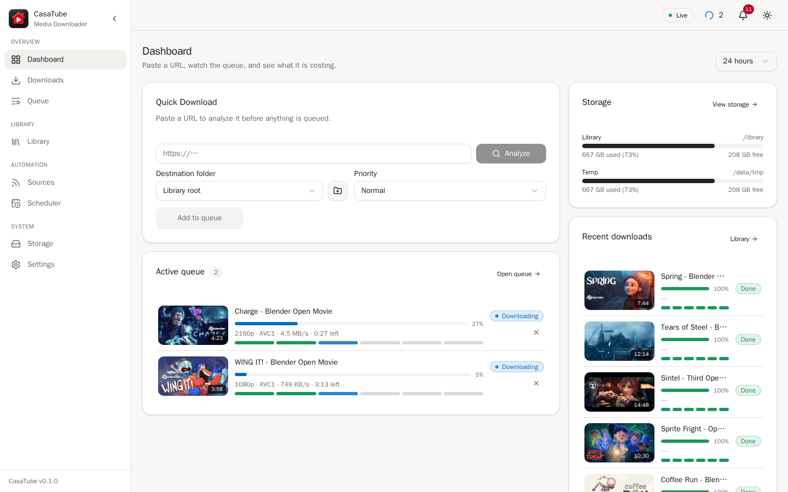
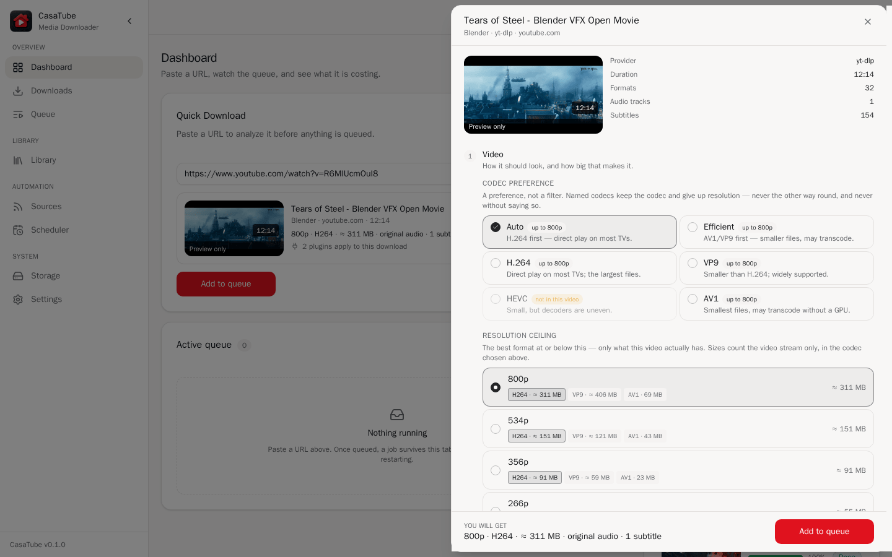
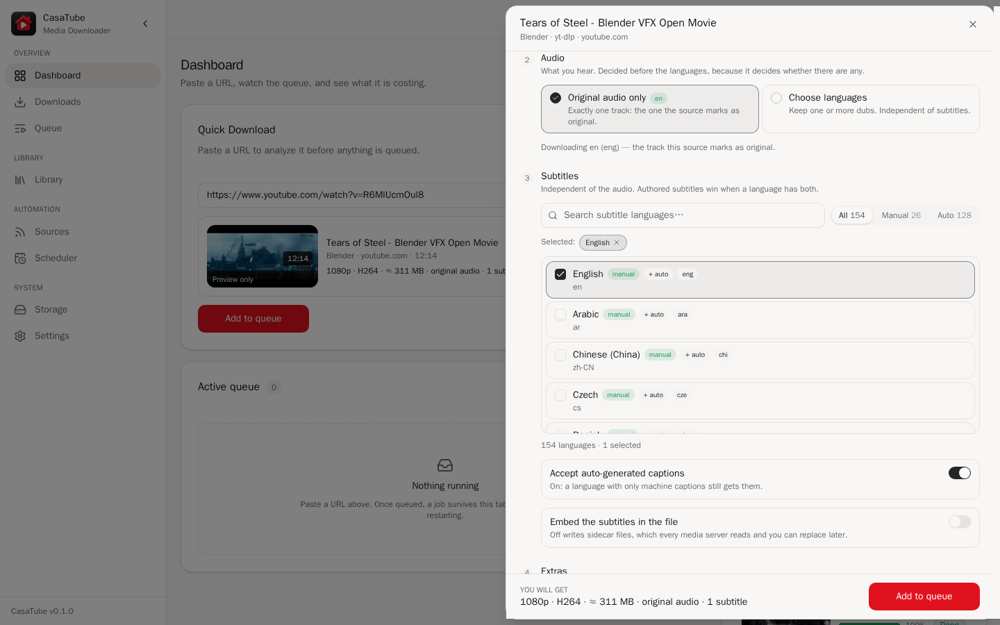
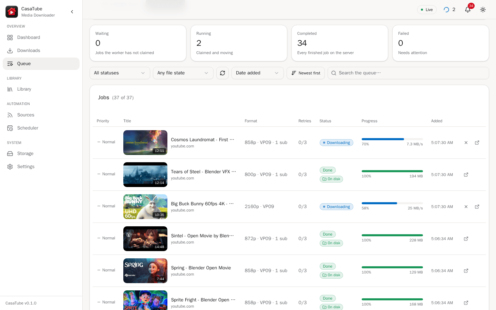
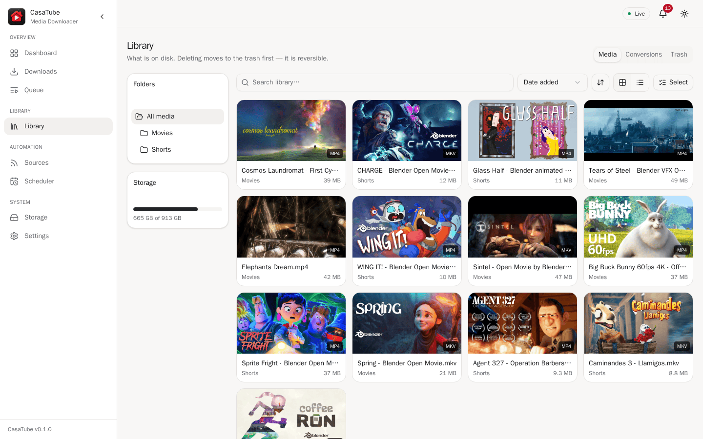
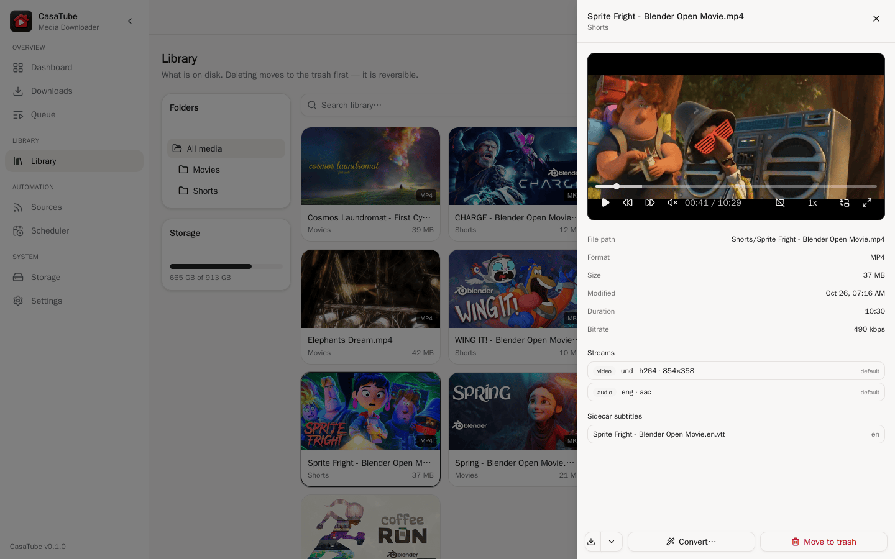
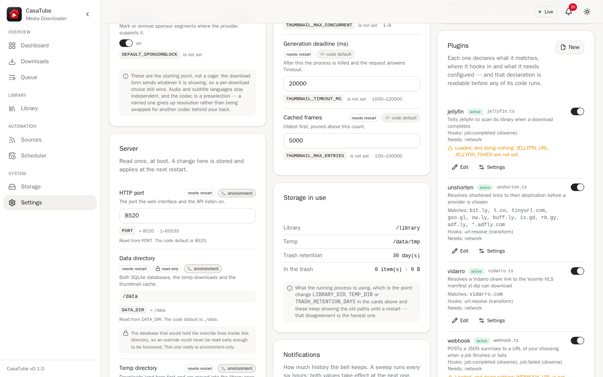
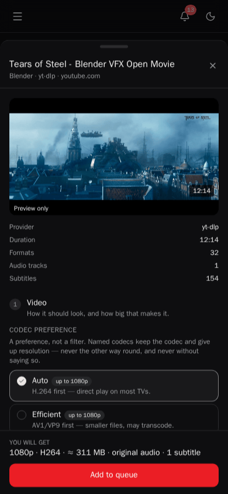
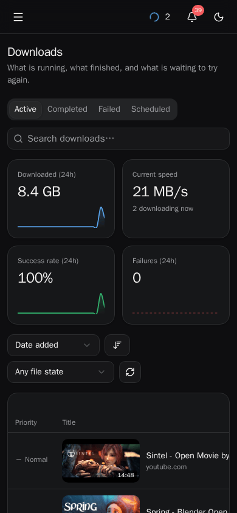

<h1 align="center">
  <picture>
    <source media="(prefers-color-scheme: dark)" srcset="docs/brand/wordmark-on-dark.png">
    
  </picture>
</h1>

<p align="center">
  A self-hosted media downloader that <strong>does not lose your work</strong>.<br>
  A real job queue on the server, yt-dlp and ffmpeg in one image, and files that land in your media library named and tagged correctly.
</p>

<p align="center">
  <a href="https://github.com/xantiagoma/casatube/actions/workflows/ci.yml"></a>
  <a href="https://github.com/xantiagoma/casatube/pkgs/container/casatube"></a>
  
  <a href="LICENSE"></a>
</p>

<p align="center">
  <picture><source media="(prefers-color-scheme: dark)" srcset="docs/screenshots/dashboard-dark.png"></picture>
</p>

---

## Why

Most self-hosted downloaders run the download inside the browser session, or
lose it when the container restarts. CasaTube is built around one requirement:
**a job survives the browser closing and the service restarting.** The browser
only watches; the server owns the queue. Close the tab, lock the iPad, redeploy
mid-download — the job carries on, or goes back to the queue and resumes.

## Features

- **A durable queue.** Six visible stages per job (validate → analyze →
  download → postprocess → metadata → move), live over SSE, with automatic
  retries, priorities and per-job logs. In-flight work returns to the
  queue on restart.
- **Choose before you download.** Paste a URL and the form shows the
  resolutions, codecs, audio tracks and subtitles *that video actually has* —
  not a generic list that silently falls back to something else.
- **Audio and subtitle languages are independent**, and the output is
  language-tagged correctly, so Jellyfin and Plex show the right names.
- **Never overwrites.** Choose the file name; a name that is taken is reported
  before queueing, and sidecars (subtitles, thumbnail) always follow the final
  name.
- **A library with a player.** Browse what was downloaded, play it in the
  browser with real seeking (HLS remux on demand), switch audio tracks and
  subtitles, download a bundle, or move things to a trash you can restore from.
- **Subscriptions.** Follow channels and playlists; new uploads are queued on a
  schedule, without re-downloading the back catalogue.
- **Sources yt-dlp cannot reach:**
  - **Private Telegram channels**, through your own signed-in session (MTProto).
  - **Google Drive** files, without the shared API key yt-dlp depends on.
  - Anything else yt-dlp supports — YouTube, Vimeo, Odysee, Dailymotion and
    [a thousand more](https://github.com/yt-dlp/yt-dlp/blob/master/supported-sites.md).
- **Plugins** in TypeScript, written in an in-app editor and loaded without a
  restart: rewrite URLs before download, notify a webhook, ask Jellyfin to scan
  when a file lands. Jellyfin, webhook, URL-unshortener and Vidarro plugins ship
  with it.
- **Credentials** for sites that need a login (cookies, passwords, API keys),
  encrypted at rest when you set a key.
- **Storage, analytics and notifications**, optional transcoding presets, and a
  UI that works on a phone or an iPad, in light and dark.

<table>
  <tr>
    <td width="50%"><picture><source media="(prefers-color-scheme: dark)" srcset="docs/screenshots/download-form-dark.png"></picture><br><sub><b>Choose before you download</b> — the codecs and resolutions this video actually has, with sizes</sub></td>
    <td width="50%"><picture><source media="(prefers-color-scheme: dark)" srcset="docs/screenshots/download-tracks-dark.png"></picture><br><sub><b>Audio and subtitles</b>, picked independently</sub></td>
  </tr>
  <tr>
    <td><picture><source media="(prefers-color-scheme: dark)" srcset="docs/screenshots/queue-dark.png"></picture><br><sub><b>The queue</b> — on the server, live over SSE</sub></td>
    <td><picture><source media="(prefers-color-scheme: dark)" srcset="docs/screenshots/library-dark.png"></picture><br><sub><b>The library</b></sub></td>
  </tr>
  <tr>
    <td><picture><source media="(prefers-color-scheme: dark)" srcset="docs/screenshots/player-dark.png"></picture><br><sub><b>Play it in the browser</b>, switching audio and subtitles</sub></td>
    <td><picture><source media="(prefers-color-scheme: dark)" srcset="docs/screenshots/settings-plugins-dark.png"></picture><br><sub><b>Plugins</b>, written and loaded from the UI</sub></td>
  </tr>
</table>

<p align="center">
  
  &nbsp;
  
</p>

<p align="center"><sub>Screenshots use <a href="https://studio.blender.org/films/">Blender Studio's open movies</a> (CC BY).</sub></p>

## Quick start

```bash
mkdir casatube && cd casatube
curl -fsSLO https://raw.githubusercontent.com/xantiagoma/casatube/main/docker-compose.yml
docker compose up -d
```

Open <http://localhost:8520>. Downloads land in `./library`, the database in
`./data`. Put the settings in a `.env` next to the compose file:

```dotenv
CASATUBE_LIBRARY=/mnt/media/videos   # where your media server looks
PUID=1000                            # the owner of that library
PGID=1000
TZ=Europe/Madrid
CREDENTIALS_KEY=                     # openssl rand -base64 48 — see below
```

Or with plain Docker:

```bash
docker run -d --name casatube --restart unless-stopped \
  -p 8520:8520 \
  -e PUID=1000 -e PGID=1000 \
  -v ./data:/data \
  -v /mnt/media/videos:/library \
  ghcr.io/xantiagoma/casatube:latest
```

**CasaOS:** App Store → Custom Install → Import, and paste
[`docker-compose.casaos.yml`](docker-compose.casaos.yml).

Everything else — every environment variable, network-mounted libraries,
permissions, updating yt-dlp, troubleshooting — is in
**[docs/DEPLOY.md](docs/DEPLOY.md)**.

## Images

`ghcr.io/xantiagoma/casatube`, for **amd64 and arm64**. yt-dlp and ffmpeg are
inside; nothing is needed on the host.

| Tag | |
|---|---|
| `latest` | The newest release with the newest yt-dlp. **Rebuilt weekly.** |
| `0.1.0` | That version with the newest yt-dlp. Rebuilt weekly. |
| `0.1.0-ytdlp-2026.08.19` | Immutable: exactly that app and that yt-dlp. |
| `main` | The tip of the `main` branch; `sha-<short>` pins one commit of it. Not a release. |

yt-dlp is the part that rots — sites change and it follows them — so the weekly
rebuild is what keeps a release downloading. Pin the immutable tag if you would
rather update on purpose.

## ⚠️ Security: put it behind something

CasaTube has **no login of its own.** It is built for one household on a
private network, and anyone who can reach the port can use it — including the
plugin editor, which **runs code on the server by design**. Do not expose it to
the internet directly. Reach it over a VPN such as Tailscale or WireGuard, or
put it behind a reverse proxy that authenticates (Authelia, Authentik, Caddy or
nginx with basic auth, Cloudflare Access).

**Set `CREDENTIALS_KEY`** before storing a cookie, a password or a Telegram
session. Without it they are stored in plain text — the app says so at every
start and on the Settings screen — and a Telegram session is your *whole
account*. Keep a copy of the key: credentials sealed with it cannot be read
without it.

See [SECURITY.md](SECURITY.md) for reporting a vulnerability.

## Telegram

To download from a private channel you are a member of:

1. Create an app at [my.telegram.org](https://my.telegram.org) → *API
   development tools* and note the `api_id` and `api_hash`. (The RSA public key
   on that page is not needed.)
2. In CasaTube: **Settings → Credentials → Telegram**, enter both and your phone
   number, then the code Telegram sends you (and your two-step password if you
   have one).
3. Paste links like `https://t.me/c/1234567890/42`.

The session is stored as a credential scoped to `t.me` and never sent back to
the browser. Revoke it from Telegram → Settings → Devices.

## Plugins

A plugin is one TypeScript file in `DATA_DIR/plugins/`, created and edited from
**Settings → Plugins**. It declares the hooks it uses — `url:resolve`,
`job:queued`, `probe:complete`, `download:complete`, `job:completed`,
`job:failed` — and the settings it needs, which appear as a form. See
**[plugins/README.md](plugins/README.md)**; the bundled plugins in
[`src/plugins/builtin/`](src/plugins/builtin/) are working examples.

## Development

Requires [Bun](https://bun.sh) 1.4+, and `yt-dlp` and `ffmpeg` on the `PATH`
for actual downloads.

```bash
bun install
bun run dev          # http://localhost:8520, reloads on change
bun test             # ~1200 tests
bun run typecheck    # bun test does not typecheck — run both
```

The frontend is bundled by the server at startup; there is no separate build
step. Before changing anything substantial, read
[`docs/DISCOVERIES.md`](docs/DISCOVERIES.md) — the traps already paid for — and
[`PLAN.md`](PLAN.md), which records each decision *and the reasoning that lost*.
[`WORKLOG.md`](WORKLOG.md) is the history, and [`HANDOFF.md`](HANDOFF.md) the
current state. [CONTRIBUTING.md](CONTRIBUTING.md) has the rest.

Built with Bun, Elysia, Drizzle + SQLite, bunqueue, React, TanStack Router and
Query, Radix/shadcn, Tailwind and media-chrome.

## Disclaimer

CasaTube is a personal, non-commercial project. Its author built it for their own household and
publishes it in case it is useful to others. It is not a company or a product, and it is not meant
to compete with or replace any service it works with. Nothing here is legal advice; if you are
unsure whether something is allowed where you live, ask someone qualified to answer.

- **Your downloads are your responsibility.** CasaTube is a tool, like a browser or a video
  recorder. Use it only for media you have the right to download and keep: your own uploads,
  works in the public domain or under a licence that allows it (Creative Commons, for example),
  and content whose owner or whose platform's terms permit downloading. Copyright law, private-copy
  exceptions and the terms of service of each site differ by country and by site, and **you** are
  the one who has to comply with them. Many platforms — YouTube among them — forbid downloading
  in their terms except through features they provide. Restrictions an owner sets on their own
  content, such as Telegram's "restrict saving content", are not enforced by CasaTube; respecting
  them is up to you. Do not redistribute what you download unless its licence lets you.
- **No DRM circumvention.** CasaTube does not decrypt, bypass or remove DRM or any other
  technical protection measure, and will not. Content protected that way is refused. Feature
  requests or pull requests for circumventing such measures will be closed.
- **Your accounts, your risk.** Cookies, passwords, API keys and Telegram sessions you add are
  used to act as *you*, under the terms of those services. Automated access through your account
  can break those terms and get it rate-limited, suspended or banned. A Telegram session in
  particular is full access to your account. Whether to add one is your call.
- **Sources change without notice.** Downloads depend on yt-dlp and on how each site works today.
  The Google Drive and Telegram providers and the Vidarro plugin read services that publish no
  stable API for this, and any of them can stop working at any time. Nothing is guaranteed to
  keep downloading.
- **Provided as is.** The software comes "as is", without warranty of any kind, as the
  [MIT licence](LICENSE) states. You use it at your own risk, and you are responsible for how you
  deploy and operate it: security (it has **no login of its own**, see above), storage, backups,
  bandwidth, and the data that passes through it, including any personal data protected by laws
  such as the GDPR.
- **No commitments.** There is no support agreement, no SLA and no guaranteed roadmap. Fixes,
  features and releases happen on a best-effort basis ([SUPPORT.md](SUPPORT.md)). Before 1.0, any
  minor release may include breaking changes.
- **Third-party software.** The Docker image bundles third-party software under its own licences,
  including GPL-licensed components (the yt-dlp release binary, ffmpeg and x264) and codecs that
  may be covered by patents in some countries (H.264, HEVC, AAC). [NOTICE](NOTICE) lists them and
  where their source code is. Checking that they suit your use is your responsibility.
- **No telemetry.** CasaTube sends nothing to its author or anyone else. The server contacts only
  the sites you ask it to download from, the services you configure (Telegram, Jellyfin,
  webhooks and anything a plugin you install calls), and GitHub if you turn on yt-dlp
  self-updates. Your browser loads thumbnails straight from the source site while you browse.
- **Not affiliated.** CasaTube is not a YouTube product and has no connection to YouTube or
  Google. YouTube, Google Drive, Dailymotion, Vimeo, Odysee, Telegram, Vidarro, Voomly, Jellyfin,
  Plex, CasaOS, Tailscale, Blender and the other names in this repository are trademarks of
  their respective owners. They appear only to describe compatibility. CasaTube is not affiliated
  with, endorsed by or sponsored by any of them, nor by the yt-dlp or FFmpeg projects, and links
  to them are not affiliate links. The films in the
  screenshots are [Blender Studio's open movies](https://studio.blender.org/films/), used under
  their Creative Commons licences ([NOTICE](NOTICE)).

## Contributing, security and licence

Issues and pull requests are welcome. [CONTRIBUTING.md](CONTRIBUTING.md) covers the setup, the
checks CI runs and how this codebase works. Report vulnerabilities privately, as
[SECURITY.md](SECURITY.md) explains, never in a public issue. Questions go where
[SUPPORT.md](SUPPORT.md) says. Everyone taking part follows the
[Code of Conduct](CODE_OF_CONDUCT.md).

The code is MIT licensed ([LICENSE](LICENSE)). [NOTICE](NOTICE) credits the third-party software
in the Docker image and the material in this repository that is not covered by the MIT licence,
including the name and logo.
